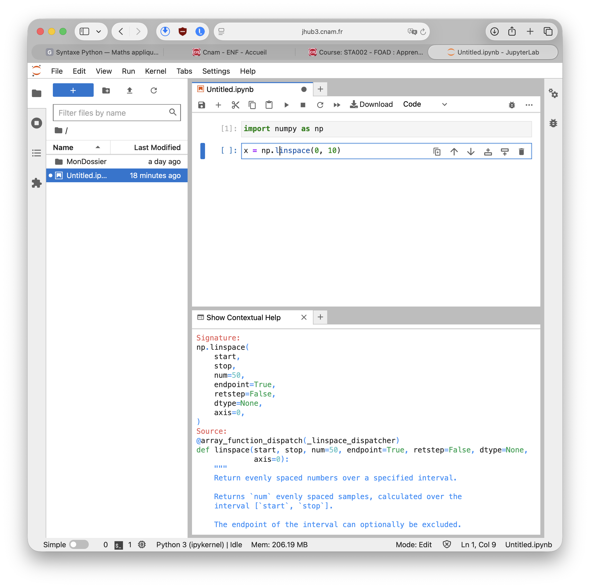

# Aide et documentation

```{raw} html
<p class="language-switch"><a href="../../en/topics/help.html">English</a></p>
```

## Aide interactive

On peut obtenir de l'aide directement dans Jupyter en cliquant sur *Interactive Help* dans le menu *Help*. L'onglet peut être déplacé dans l'interface Jupyter Lab là cela vous convient.

L'aide interactive présente la documentation de la fonction (grâce à la *docstring*) sur laquelle votre curseur est 



La documentation inclut un «signature»

```
np.linspace(
    start,
    stop,
    num=50,
    endpoint=True,
    retstep=False,
    dtype=None,
    axis=0,
    *,
    device=None,
)
```

La **signature** d’une fonction indique son nom, les arguments qu’elle accepte et leurs valeurs par défaut. La signaturede {funcindex}`np.linspace`,
`start` et `stop` sont des arguments obligatoires, car aucune valeur par défaut ne leur est associée.
Les arguments suivants sont facultatifs: par exemple, `num=50` signifie que la fonction produit 50 valeurs par défaut,
tandis que `endpoint=True` indique que la valeur `stop` est incluse.
Pour modifier une option, on peut la nommer explicitement, comme dans `np.linspace(0, 1, num=20, endpoint=False)`.
Le symbole `*` ne correspond pas à une valeur à fournir: il indique que les arguments placés après lui doivent obligatoirement être transmis par leur nom. Ainsi, `device` doit être écrit sous la forme `device=...`.

En dessous de la signature, la documentation indique le rôle que joue chacun de ces paramètres.

## Source de documentation

Sauf mention contraire la documentation est fournie en anglais.

### Python

- [Documentation officielle Python en français](https://docs.python.org/fr/3/) — point d’entrée général.
- [Tutoriel Python](https://docs.python.org/fr/3/tutorial/) — apprentissage progressif du langage.
- [Bibliothèque standard](https://docs.python.org/fr/3/library/) — documentation des fonctions intégrées et des modules comme `math`, `statistics` ou `random`.
- [Référence du langage](https://docs.python.org/fr/3/reference/) — description précise de la syntaxe et du comportement du langage.
- [Index général](https://docs.python.org/fr/3/genindex.html) — recherche alphabétique des fonctions et notions.
- [PEP 8](https://peps.python.org/pep-0008/) — conventions de style pour le code Python.
- [PEP 257](https://peps.python.org/pep-0257/) — conventions relatives aux docstrings.

La traduction française peut être incomplète sur certaines pages. Il est alors utile de consulter la [version anglaise](https://docs.python.org/3/).

### NumPy

- [Documentation générale de NumPy](https://numpy.org/doc/stable/) — point d’entrée principal.
- [Guide utilisateur](https://numpy.org/doc/stable/user/) — tableaux, indexation, types, broadcasting, copies et vues.
- [Notions fondamentales pour débutants](https://numpy.org/doc/stable/user/absolute_beginners.html) — introduction accessible.
- [Guide de démarrage rapide](https://numpy.org/doc/stable/user/quickstart.html) — présentation condensée des opérations courantes.
- [Référence de l’API](https://numpy.org/doc/stable/reference/) — signatures et comportement détaillé de toutes les fonctions.
- [Index général](https://numpy.org/doc/stable/genindex.html) — recherche alphabétique.
- [Tutoriels NumPy](https://numpy.org/numpy-tutorials/) — notebooks et exemples guidés.

Pour vérifier précisément une fonction comme `numpy.linspace`, `numpy.linalg.solve` ou `numpy.fft.fft`, la référence de l’API est généralement la meilleure source.

### Matplotlib

- [Documentation générale de Matplotlib](https://matplotlib.org/stable/) — point d’entrée principal.
- [Guide de démarrage rapide](https://matplotlib.org/stable/users/explain/quick_start.html) — création d’une figure, axes, courbes, légendes et annotations.
- [Guide utilisateur](https://matplotlib.org/stable/users/index.html) — explications organisées par thème.
- [Tutoriels](https://matplotlib.org/stable/tutorials/index.html) — parcours d’apprentissage.
- [Galerie d’exemples](https://matplotlib.org/stable/gallery/index.html) — graphiques accompagnés de leur code source.
- [Référence de l’API](https://matplotlib.org/stable/api/index.html) — documentation exhaustive des fonctions et objets.
- [Référence de `matplotlib.pyplot`](https://matplotlib.org/stable/api/pyplot_summary.html) — fonctions comme `plot`, `scatter`, `xlabel`, `legend` et `show`.
- [Liste des types de graphiques](https://matplotlib.org/stable/plot_types/index.html) — choix visuel d’un type de représentation.

Pour Matplotlib, la galerie est souvent le meilleur point de départ : trouvez un graphique proche du résultat recherché, puis consultez la référence de l’API pour les détails.
