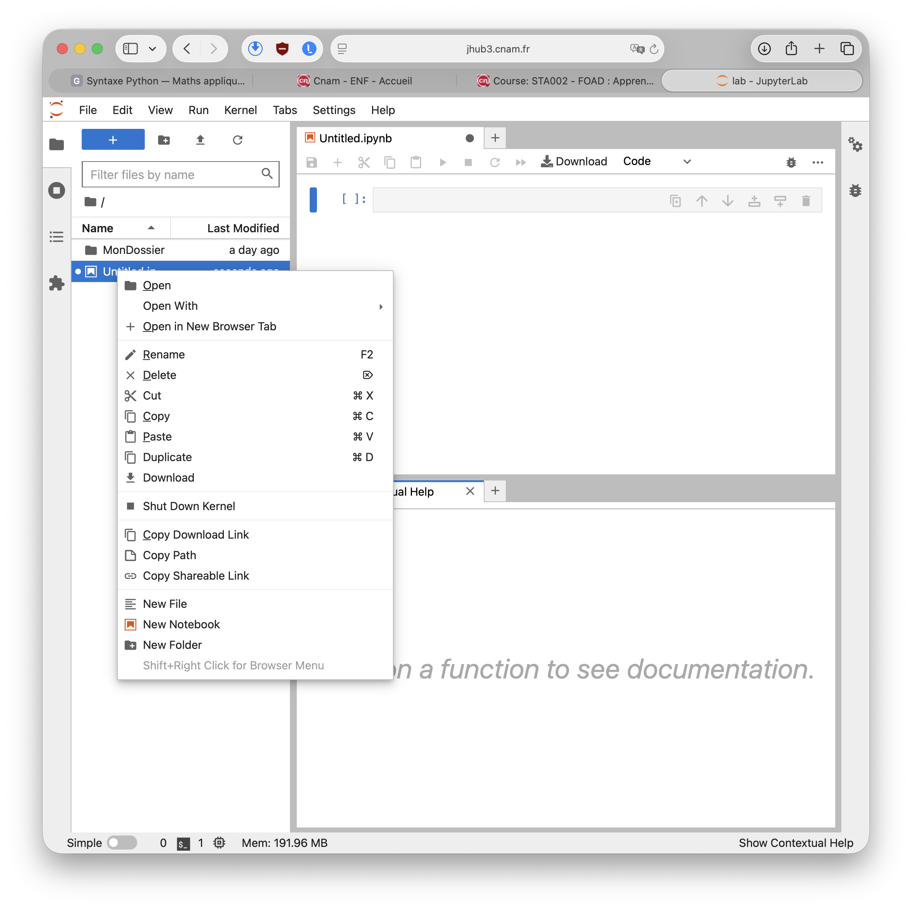
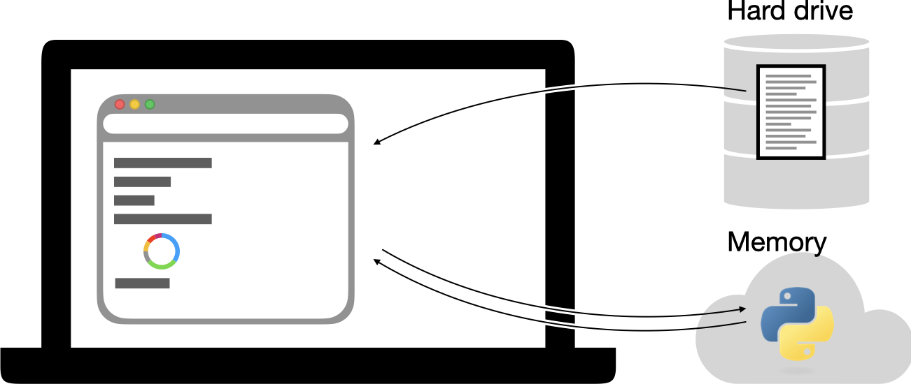

# Travailler dans Jupyter

```{raw} html
<p class="language-switch"><a href="../../en/topics/jupyter.html">English</a></p>
```

## Vue générale

{concept}`JupyterLab` est un environnement de travail accessible depuis un navigateur web. Il permet de créer, d’ouvrir et de modifier différents types de fichiers, notamment des carnets Jupyter (`.ipynb`), des scripts Python et des fichiers texte.



Son interface est organisée en plusieurs zones :

- À gauche, l’explorateur de fichiers permet de parcourir les dossiers, de créer ou renommer des fichiers, de les télécharger et de les supprimer. Un clic droit ouvre le menu contextuel présenté sur la capture.
- Au centre, la zone de travail affiche les documents ouverts dans des onglets. Ici, elle contient un carnet Jupyter composé de cellules dans lesquelles on peut saisir puis exécuter du code.
- En haut, la barre de menus et la barre d’outils donnent accès aux principales commandes : enregistrer le document, ajouter ou déplacer des cellules, exécuter du code et contrôler le noyau Python.
- Les panneaux latéraux et inférieurs peuvent afficher des outils complémentaires, comme l’aide contextuelle, les noyaux actifs ou les terminaux.

Les fichiers manipulés dans JupyterLab sont de véritables fichiers enregistrés dans l’espace de travail accessible par le serveur. Selon la plateforme utilisée, cet espace peut correspondre à un dossier de l’ordinateur ou à un espace distant. Il est donc important d’enregistrer régulièrement son travail et, sur une plateforme en ligne, de télécharger une copie des fichiers que l’on souhaite conserver.

## Fonctionnement

Un carnet Jupyter fait intervenir trois éléments distincts : l’interface affichée dans le navigateur, le fichier `.ipynb` enregistré sur le disque et le noyau Python actif en mémoire.



Le navigateur affiche le carnet et permet de modifier ses cellules. Le contenu du document — cellules de code ou de texte, résultats enregistrés et métadonnées — est conservé dans un fichier au format `.ipynb`. Lorsque le carnet est enregistré, les modifications apportées dans le navigateur sont écrites dans ce fichier. À l’inverse, l’ouverture d’un fichier `.ipynb` permet à JupyterLab d’en reconstruire la présentation dans le navigateur. Le fichier constitue donc la version persistante du carnet : il reste disponible après la fermeture de JupyterLab ou l’arrêt de l’ordinateur.

L’exécution du code est assurée par un processus séparé appelé **noyau** (*kernel*). Lorsque l’utilisateur exécute une cellule, JupyterLab transmet son code au noyau Python. Celui-ci effectue le calcul, puis renvoie le résultat ou un éventuel message d’erreur au navigateur. Le noyau conserve en mémoire les variables, les fonctions définies et les modules importés au cours de la session. C’est pourquoi une cellule peut utiliser une variable créée auparavant, même si les cellules n’ont pas été exécutées dans l’ordre où elles apparaissent.

Il faut ainsi distinguer l’enregistrement du carnet et l’état du noyau. Enregistrer le fichier `.ipynb` conserve les cellules et leurs résultats affichés, mais pas les objets Python présents en mémoire. À l’inverse, redémarrer ou arrêter le noyau efface les variables et les fonctions définies pendant la session, sans supprimer le fichier ni modifier son contenu enregistré. Après un redémarrage, il faut donc exécuter de nouveau les cellules nécessaires, de préférence dans l’ordre, depuis le début du carnet.

## Cellules

Un carnet Jupyter (ou *notebook*) est composé de cellules. Une {concept}`cellule de code` exécute du
Python ; une {concept}`cellule Markdown` contient des explications et des formules.
Exécutez la cellule sélectionnée avec {kbd}`Maj`+{kbd}`Entrée`: pour une cellule de code, le code est exécuté; pour une cellule Markdown, le rendu HTML est produit.

L'ordre d'exécution est important. Le nombre affiché à côté d'une cellule
indique quand elle a été exécutée (pas sa position dans la page). Si les résultats
semblent incohérents, inspectez ces numéros pour tenter de trouver la cause de l'incohérence. Vous pouvez également redémarrer le noyau et exécutez toutes les cellules du haut
vers le bas (Menu *Run* puis *Run all cells* ou *Run all above cells* par exemple).

## Mode commande et mode édition

L'interaction avec le carnet Jupyter est de deux types :

* {concept}`mode édition` pour éditer le contenu d'une cellule
* {concept}`mode commande` pour manipuler les cellules

Le mode édition modifie le contenu de la cellule. Le mode commande agit
sur la cellule entière.

Il est très utile de connaître des raccourcis utiles qui faciliteront grandement votre travail. L'essentiel des raccourcis est rappelé directement dans les menus.

En mode édition, {kbd}`Entrée` passe en mode édition et {kbd}`Échap` revient au mode commande.

En mode commande:

- {kbd}`A` et {kbd}`B` ajoutent une cellule au-dessus (*above*) ou en dessous
  (*below*) ;
- {kbd}`C`, {kbd}`V` et {kbd}`X` copient, collent et coupent une cellule ;
- {kbd}`M` transforme la cellule en Markdown ;
- {kbd}`Y` transforme la cellule en code Python ;
- {kbd}`1`, {kbd}`2`, {kbd}`3` transforment une cellule Markdown en titre du
  niveau correspondant.

Si on sélectionne plusieurs cellules, on peut copier ou couper plusieurs cellules avec les mêmes raccourcis.

- {kbd}`M` fusionne toutes les cellules en une seule cellule.

Pour diviser une cellule en deux:

- {kbd}`Ctrl` + {kbd}`Shift` + {kbd}`-` fusionne une seule cellule en deux cellule.

En mode édition, {kbd}`Maj`+{kbd}`Entrée` exécute la cellule et sélectionne la
suivante. Les raccourcis peuvent varier légèrement entre JupyterLab et le
Notebook classique ; consultez la palette de commandes de votre interface.

Voir aussi [Syntaxe Markdown et formules](markdown.md).
